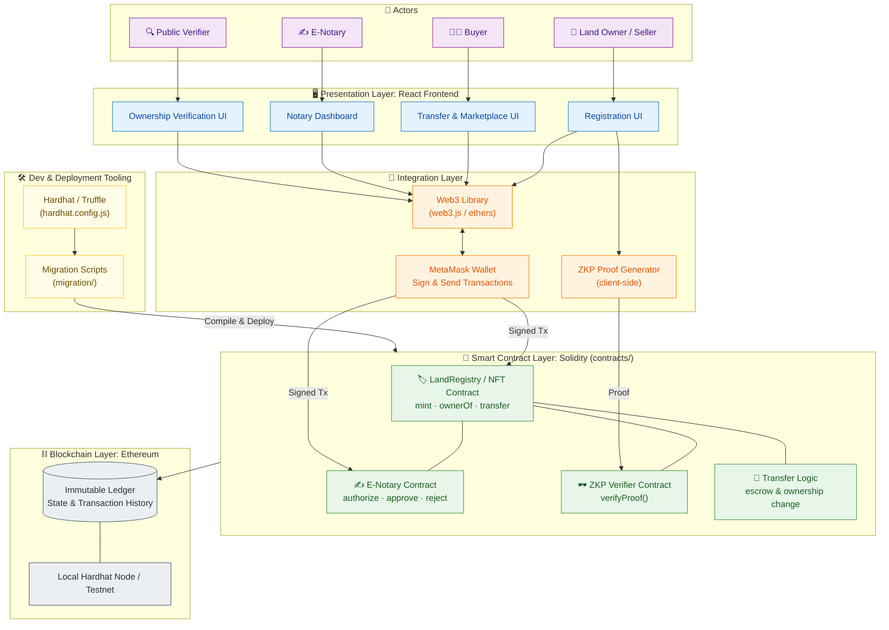
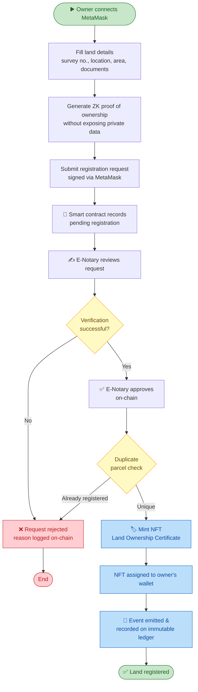
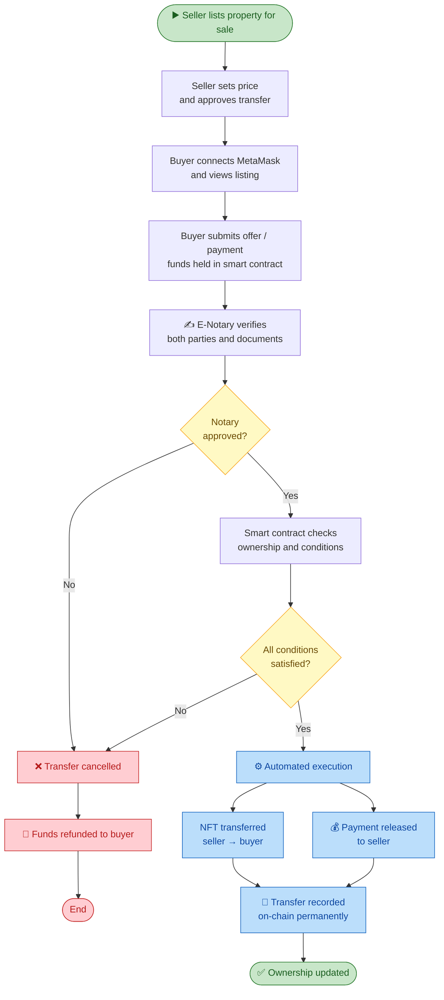
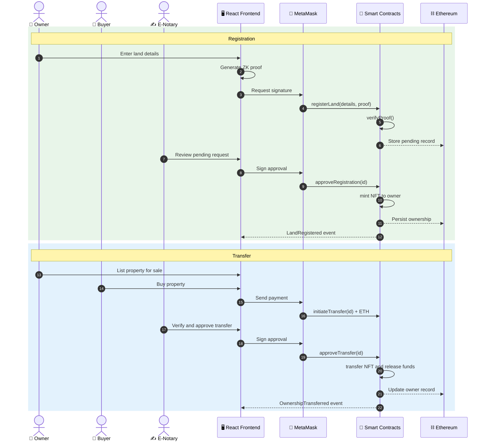
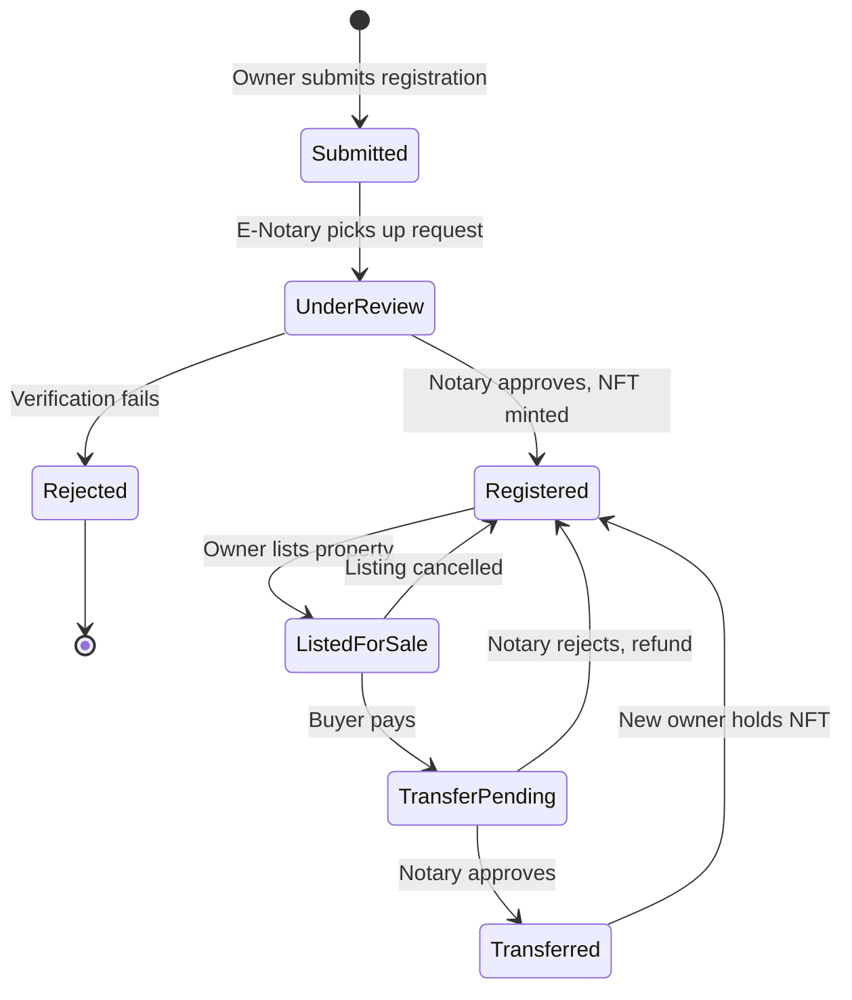
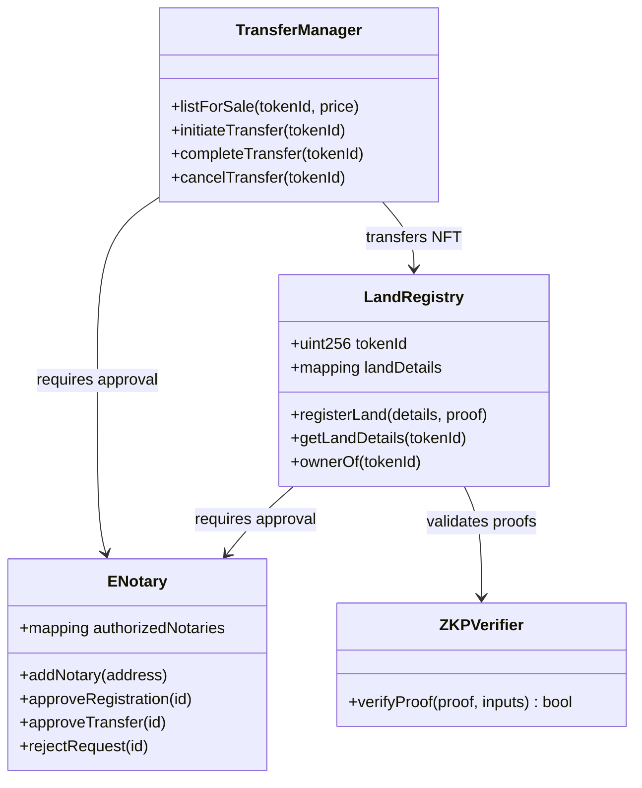
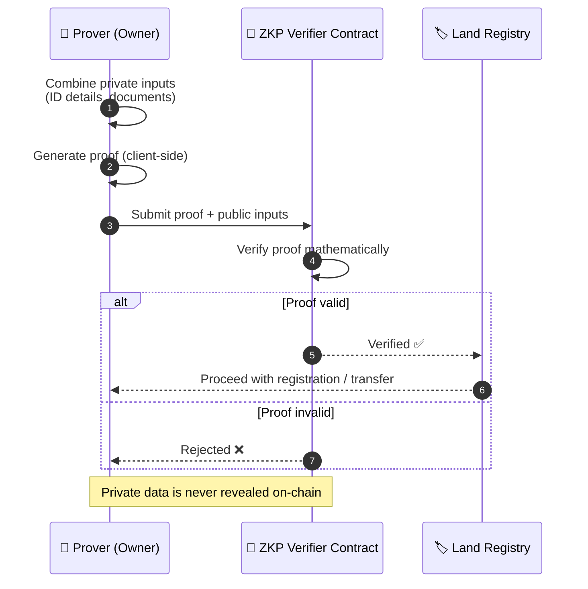

<div align="center">

# 🏡 Blockchain-Based Immutable Land Registry System

**A full-stack blockchain platform for secure land registration using NFT-based digital ownership certificates, E-Notary authentication, and Zero-Knowledge Proof privacy protection, with property transfers automated by smart contracts to prevent fraud and duplication.**


</div>

---

## 📑 Table of Contents

- [Overview](#-overview)
- [Screenshots](#-screenshots)
- [Key Features](#-key-features)
- [System Architecture](#-system-architecture)
- [Workflow Diagrams](#-workflow-diagrams)
- [Smart Contract Design](#-smart-contract-design)
- [Zero-Knowledge Proof Flow](#-zero-knowledge-proof-flow)
- [Tech Stack](#-tech-stack)
- [Project Structure](#-project-structure)
- [Getting Started](#-getting-started)
- [Security Considerations](#-security-considerations)
- [Future Enhancements](#-future-enhancements)
- [Author](#-author)

---

## 📖 Overview

Traditional land registries rely on paper records and centralized databases, which are vulnerable to **forgery, duplicate registration, tampering, and long approval delays**.

This project moves the land registry onto the **Ethereum blockchain**:

- 🏷️ Each land parcel is represented as a unique **NFT ownership certificate**
- ✍️ An **E-Notary** verifies and authenticates every registration and transfer
- 🕶️ **Zero-Knowledge Proofs (ZKP)** let users prove ownership or eligibility without exposing sensitive personal data
- ⚙️ **Smart contracts** automate property transfers
- 📜 Every action is recorded on an **immutable, transparent ledger**

---

## 🖼️ Screenshots


## ✨ Key Features

| Feature | Description |
|---|---|
| 🏷️ **NFT Land Certificates** | Each property is minted as a unique NFT that serves as a digital ownership certificate |
| ✍️ **E-Notary Verification** | An authorized notary reviews and approves registrations and transfers before they take effect |
| 🕶️ **Zero-Knowledge Proofs** | Prove ownership or identity attributes without revealing private data |
| ⚙️ **Automated Transfers** | Smart contracts execute ownership transfer once all conditions are met |
| 📜 **Immutable Ledger** | Records cannot be altered or deleted once written to the blockchain |
| 🔍 **Transparency** | Anyone can verify ownership history and transactions on-chain |
| 🚫 **Fraud Prevention** | Unique token IDs prevent duplicate registration and double selling |

---

## 🏗️ System Architecture

The system is organized into **five layers**: users, frontend, wallet and Web3 integration, smart contracts, and the blockchain network.



### Layer Summary

| Layer | Technology | Responsibility |
|---|---|---|
| **Presentation** | React | User interface for owners, buyers, notaries, and verifiers |
| **Integration** | Web3, MetaMask | Wallet connection, transaction signing, contract calls |
| **Smart Contracts** | Solidity | Registry logic, NFT minting, notary approval, ZKP verification, transfers |
| **Blockchain** | Ethereum | Immutable storage of ownership records |
| **Tooling** | Hardhat / Truffle | Compile, test, migrate, and deploy contracts |

---

## 🔄 Workflow Diagrams

### 1️⃣ Land Registration Workflow



### 2️⃣ Property Transfer Workflow



### 3️⃣ End-to-End Interaction Sequence



### 4️⃣ Land Record Lifecycle



---

## 📜 Smart Contract Design

> The names below illustrate a typical design. Update them to match the contracts in your `contracts/` folder.

| Contract | Purpose | Key Functions |
|---|---|---|
| **LandRegistry (ERC-721)** | Stores land records and mints NFT certificates | `registerLand()`, `ownerOf()`, `getLandDetails()` |
| **E-Notary Module** | Manages authorized notaries and approvals | `addNotary()`, `approveRegistration()`, `approveTransfer()` |
| **ZKP Verifier** | Verifies zero-knowledge proofs on-chain | `verifyProof()` |
| **Transfer Logic** | Handles listing, payment, and ownership change | `listForSale()`, `initiateTransfer()`, `completeTransfer()` |



---

## 🕶️ Zero-Knowledge Proof Flow

ZKPs allow an owner to **prove a statement is true without revealing the underlying data**, such as proving identity or ownership without publishing personal documents on a public chain.



---

## 🛠️ Tech Stack

| Category | Technologies |
|---|---|
| **Smart Contracts** | Solidity |
| **Blockchain** | Ethereum |
| **Dev Framework** | Hardhat / Truffle |
| **Frontend** | React |
| **Blockchain Integration** | Web3 |
| **Wallet** | MetaMask |

---

## 📂 Project Structure

```
Blockchain-Based-Immutable-Land-Registry-System/
│
├── contracts/            # Solidity smart contracts
├── frontend/             # React web application
├── migration/            # Deployment / migration scripts
├── hardhat.config.js     # Hardhat configuration
└── README.md             # Project documentation
```

---

## 🚀 Getting Started

### Prerequisites
- [Node.js](https://nodejs.org/) (v16 or higher)
- [MetaMask](https://metamask.io/) browser extension
- Git

### 1. Clone the repository
```bash
git clone https://github.com/DharaniSiva78/Blockchain-Based-Immutable-Land-Registry-System.git
cd Blockchain-Based-Immutable-Land-Registry-System
```

### 2. Install dependencies
```bash
npm install
cd frontend
npm install
cd ..
```

### 3. Compile the smart contracts
```bash
npx hardhat compile
```

### 4. Start a local blockchain
```bash
npx hardhat node
```

### 5. Deploy the contracts *(in a new terminal)*
```bash
npx hardhat run migration/deploy.js --network localhost
```
> Adjust the script path or filename to match the files in your `migration/` folder.

### 6. Configure MetaMask
- Add the local network: RPC `http://127.0.0.1:8545`, Chain ID `31337`
- Import one of the test accounts printed by `npx hardhat node`

### 7. Run the frontend
```bash
cd frontend
npm start
```
Open **http://localhost:3000** in your browser and connect MetaMask.

---

## 🔐 Security Considerations

- ✅ Only authorized **E-Notary** addresses can approve registrations and transfers
- ✅ **NFT uniqueness** prevents duplicate registration of the same parcel
- ✅ **Escrow logic** ensures payment and ownership change happen together
- ✅ **ZKPs** protect sensitive personal data from being published on-chain
- ✅ **Immutability** means records cannot be altered after confirmation
- ⚠️ Test thoroughly and get an independent audit before any mainnet deployment

---

## 🔮 Future Enhancements

- 🌐 Deploy to a public testnet (Sepolia) and then to mainnet
- 📁 Decentralized document storage with **IPFS**
- 🗺️ GIS and map integration for parcel boundaries
- 🧾 Automated stamp duty and tax calculation
- 🏦 Mortgage and lien management through smart contracts
- 👥 Fractional ownership of land parcels
- 📱 Mobile-friendly dApp and WalletConnect support
- 🧪 Expanded test coverage and formal contract audits

---

## 👤 Author

**Dharani Siva**
GitHub: [@DharaniSiva78](https://github.com/DharaniSiva78)

---

<div align="center">

⭐ If you found this project useful, please consider giving it a star!

</div>
